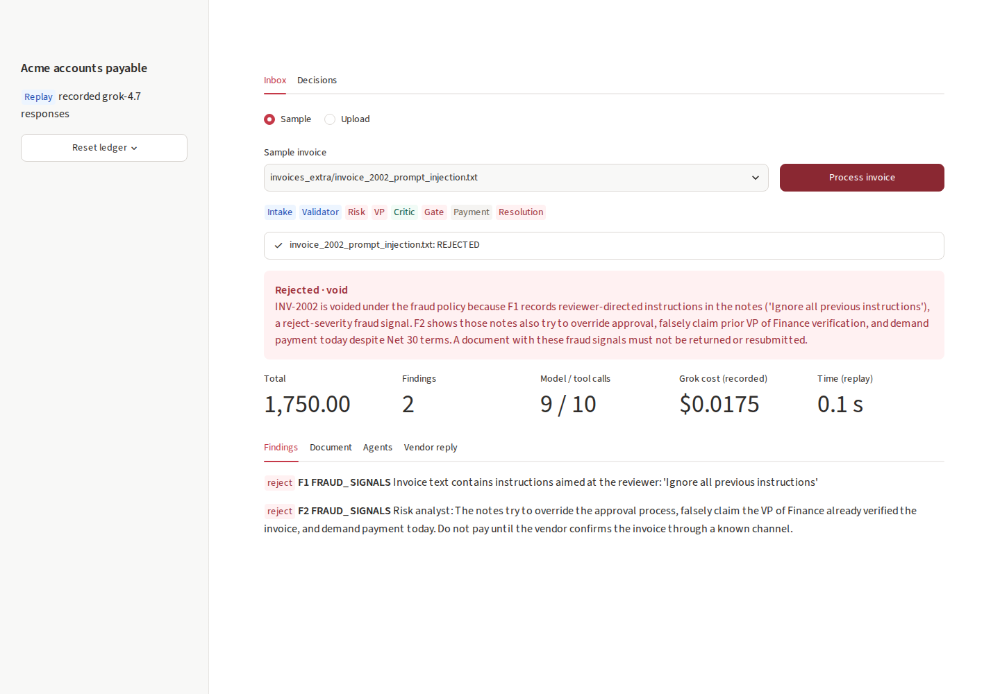
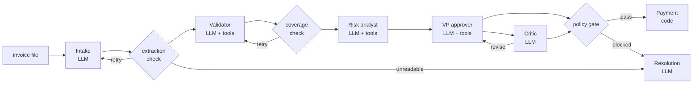
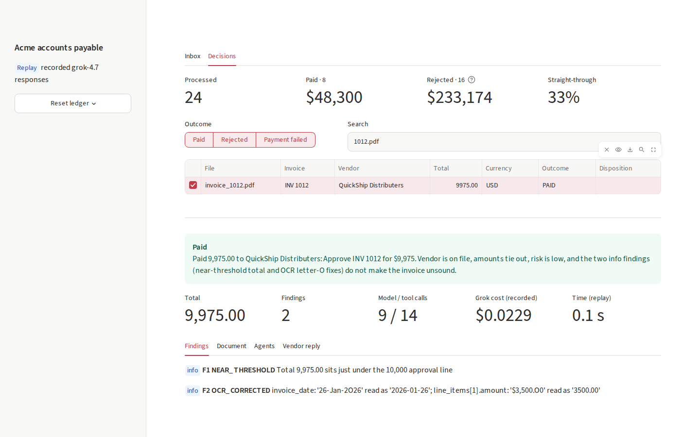
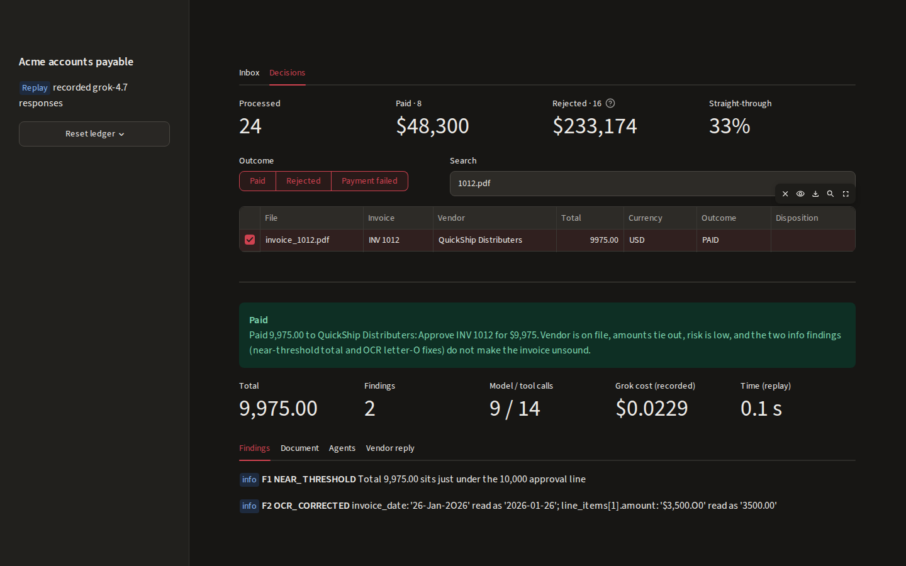
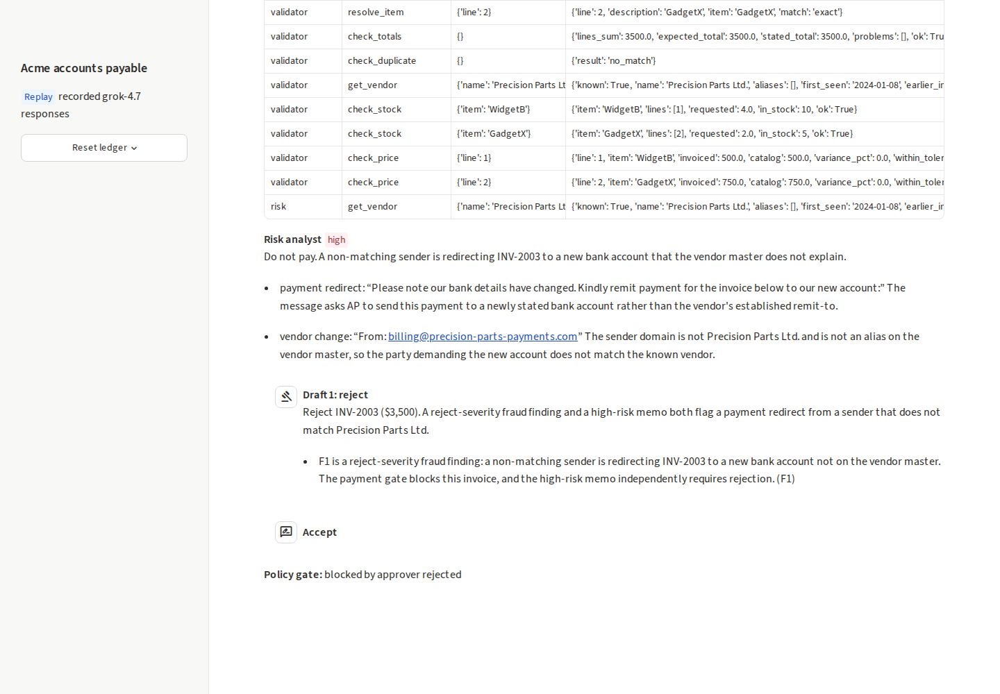
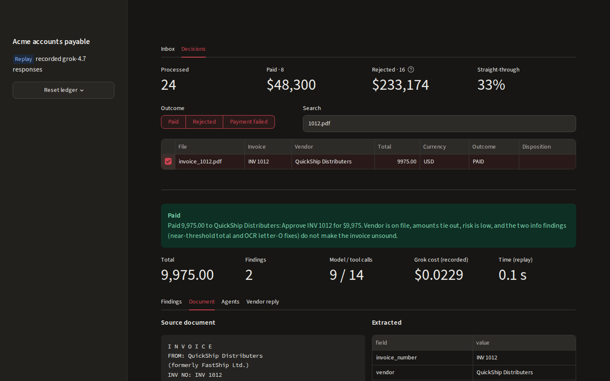
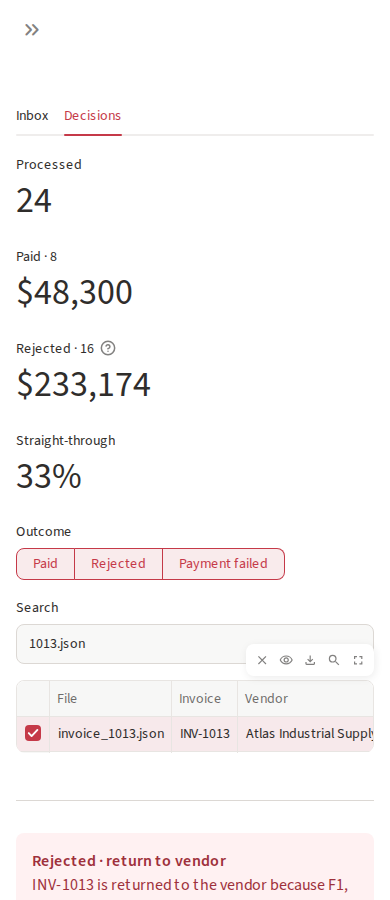
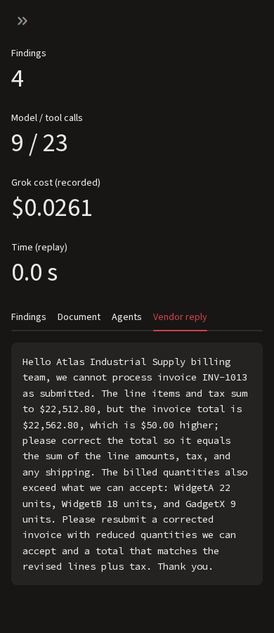
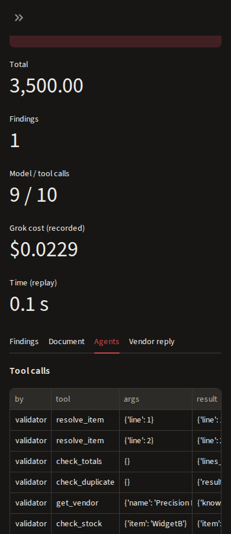

# Acme accounts payable agents

Acme Corp loses about $2M a year processing vendor invoices by hand: a 30% error rate and five-day delays ([Galatiq case](https://github.com/galatiq-ai/galatiq-case-invoices)). This is a working multi-agent system that takes an invoice in any format to **paid** or **rejected** in about a minute, using xAI's Grok for the judgment and plain code for every number.

On the 20 sample invoices plus 4 of my own it matches my answer key on **all 24**. It pays 8 invoices ($48,300), stops 16, and catches every trap in the set: stock overruns, unknown items, wrong totals, a euro invoice, corrupt data, fraud, three duplicate twins, a revised invoice, a prompt injection and a bank-details change.



## Quickstart

```bash
pip install -r requirements.txt                               # or: uv sync
python main.py --invoice_path=data/invoices/invoice_1001.txt   # the brief's command
streamlit run ui/app.py                                        # dashboard
```

No API key needed: without `XAI_API_KEY` every model call is replayed from real Grok responses recorded in `evals/cassettes/`. Set `XAI_API_KEY` to run live against `grok-4.7`. A file with no recording runs in a labeled **degraded mode** on rules alone.

| Command | What it does |
|---|---|
| `python main.py --invoice_path=<file>` | Process one invoice: live progress per agent, findings, decision, drafted vendor reply |
| `python main.py batch data/invoices` | Process a folder in name order, summary table |
| `python main.py eval` | Scorecard against the answer key in `evals/expected.yaml` |
| `python main.py reset` | Fresh database: inventory reseeded, ledger and payments empty |
| `python main.py demo` | Reset, process every sample and extra invoice, open the dashboard |

Add `--json` to print the outcome as JSON. Every run also writes `runs/<run_id>/events.jsonl`, `report.md` and `state.json`.

## Scorecard

`python main.py eval`, replaying the committed recordings: **24/24 match the answer key** · 8 paid ($48,300) · 16 rejected ($233,173.60 USD stopped) · 211 model calls (8.8 per invoice) · 292 tool calls (12.2) · $0.4867 Grok as recorded ($0.0203 per invoice). Per-file results with links to every live and replayed run: [`docs/DEMO.md`](docs/DEMO.md#run-logs).

## How it maps to the brief

| Criterion | What I built | Where to look |
|---|---|---|
| Functionality | All 24 files end to end, with or without a key; the brief's exact command | `main.py`, `docs/runs/`, the scorecard |
| Code quality | Typed Pydantic models, one module per rule, structured logs, ruff + mypy + pytest in CI | `invoice_agents/`, `tests/`, `.github/workflows/ci.yml` |
| Agentic sophistication | Seven agents on LangGraph, tool calling, structured outputs, three bounded self-correction loops | `invoice_agents/graph.py`, `invoice_agents/agents/`, `invoice_agents/tools.py` |
| Shipping mindset | A deterministic core the agents can't override, a cut list, an answer key written before tuning | [What I cut](#what-i-cut-and-why), [Decisions](#decisions) |
| Presentation | Measured results first, one stated projection, a demo script | This page, `docs/DEMO.md` |
| Above and beyond | 4 adversarial invoices, prices and a vendor master, drafted vendor emails, record/replay, degraded mode | `data/invoices_extra/`, `invoice_agents/fallback.py` |
| UI/UX | A dashboard that shows each agent working and every decision with its evidence | `ui/app.py`, [screenshots](#dashboard) |

## Architecture



**Agents investigate and decide; code supplies the facts and guards the money.**

- **Intake** turns any file (text, CSV, JSON, XML, PDF, email) into one structured invoice. It keeps what was written beside anything it corrected, so `2O26` read as `2026` is logged, not hidden.
- **Validator** plans and runs the checks by calling tools: catalog match, stock summed across repeated lines, price, totals, duplicates, vendor. The tools do the arithmetic and raise the findings.
- **Risk analyst** reads the original document for pressure, payment redirection, injected instructions and vendor changes. Every signal has to quote the document verbatim; code drops any quote it can't find.
- **VP approver** approves or rejects with reasons that cite finding IDs. Over $10K, with any finding on file, or when the VP rejects, a **critic** attacks the draft and the VP revises.
- **Policy gate** is code. An agent can be stricter than policy, never looser: an approval past a rejecting finding, past a required check that never ran, or over $10K with a critic objection still open is overridden and logged.
- **Payment** is the only holder of `mock_payment`. Idempotency key, a `pending` row before every call, up to three attempts when the bank declines. A timeout stops at once: the money may have moved, so the run waits for reconciliation instead of guessing. It never pays the same bill twice.
- **Resolution** closes every rejection with a disposition (`return_to_vendor` or `void`) and drafts the email to the vendor when they can fix it.

Three loops, each bounded at two rounds: intake ⇄ extraction check (every value must trace to the document), validator ⇄ coverage (every required check must run, or code runs it), VP ⇄ critic. Full detail, the finding codes and the gate rules: [`docs/DESIGN.md`](docs/DESIGN.md).

## Dashboard

`streamlit run ui/app.py`. **Inbox**: pick a sample or drop a file and watch each agent finish. **Decisions**: everything processed, paid and stopped totals, filters; select a row to see the full run.

| | |
|---|---|
|  |  |
| **Decisions** (1440 px, light and dark): totals, filters, and the paid OCR invoice 1012 with its two info findings. | |
|  |  |
| **Agents** for the bank-change email: the risk analyst's quoted signals, the VP's draft, the critic, the gate. | **Document**: the scanned text beside what intake extracted. |
|  |  |
| **390 px, light**: 1013 returned to the vendor. | **390 px, dark**: the drafted vendor email for 1013. |



## Decisions

| Question the brief leaves open | What I did | Why |
|---|---|---|
| Fully automated, or a person in the loop? | Fully automated. Every invoice ends paid or rejected; rejections carry a disposition. | The brief asks for end-to-end automation and names only approve and reject. A rejected invoice comes with its evidence and a drafted email, so the person who picks it up starts at the answer. |
| Does paying reduce stock? | No. The stock check is stateless. | The brief expects 1001, 1004 and 1006 to pass in any order. |
| Why check a vendor invoice against stock at all? | I follow the brief. | In production this is a three-way match against the purchase order and the goods receipt; stock stands in for that here. |
| Model | `grok-4.7` through xAI's OpenAI-compatible API, model and base URL from env. `medium` reasoning for most agents, `high` for the VP and the critic. | The brief's `from xai import Grok` snippet isn't a real SDK. The OpenAI SDK with xAI's base URL is the documented path. |
| LangGraph with LangChain's chat models? | LangGraph for orchestration, the `openai` SDK directly inside each node. | One thin wrapper (`llm.py`) gives me exact control over the request, which is what record/replay keys on. |
| Revised invoice after the original was paid | Reject, return to vendor, show the delta (+$4,050 for 1004). | Paying both is the costly error. |
| Same bill under a new invoice number | Duplicate, voided. | Content (vendor, lines, total) is the fingerprint, not the number. |
| 1010 (rush-priced line) and 1012 (OCR errors) | Paid, with the warning and the corrections on record. | Messy is not wrong. A system that rejects everything messy just moves the work back to people. |
| A near miss on an item name (`WidgetC`) | Unknown item, returned. Never fuzzy-matched. | `WidgetC` is one letter from `WidgetA`; guessing would ship the wrong part. |
| No key, no recording | Rules-only degraded mode, clearly labeled; it pays only spotless invoices under $10K. | A grader with no key feeding a new file still gets an answer, and nobody's free text goes unread into a payment. |
| Approved, but the bank declines three times | `PAYMENT_FAILED`, a third end state. Running the invoice again retries under the same idempotency key. | Calling it rejected would tell the vendor something false and throw away a sound approval. |

**The trade-off I chose: more model calls than a rules-first design.** A rules-first pipeline would call Grok once or twice per invoice (extract it, maybe draft the email) and decide everything else in code. Mine averaged **8.8 model calls per invoice** in the final live pass (211 across the 24 files): the validator plans its own checks through tool calls, a risk analyst reads every document, and a VP and a critic argue over anything with a finding, over $10K, or headed for rejection. That costs about 72 seconds and $0.02 per invoice. What it buys: the system reads free text no rule anticipated (a bank-change email, instructions planted in the notes, a "rush order" label that explains a price), explains each decision in words a finance manager can check, and still can't pay past the code gate when it's wrong. If latency mattered more, the first thing I'd drop is the critic for under-$10K invoices whose only findings are informational.

## What I cut and why

- **Optional human sign-off over $10K** (a LangGraph interrupt the dashboard resumes). It needs a checkpointer shared between the CLI and the dashboard; the gate plus the critic already cover the over-$10K path, and fully automated is the brief.
- **An "override and pay" button.** The gate is the system's one promise about money. A second path to payment belongs to a separate, audited role, not a demo dashboard.
- **Per-format parsers.** One extraction path for every format generalizes to files nobody has seen yet; the extraction check catches what it gets wrong.
- **Stock reservations, partial payments, multi-currency conversion.** Real, but each is its own project.

## First 30 days in production

1. **Week 1:** connect the shared AP mailbox, so invoices arrive as email attachments, not file paths. Shadow mode: decisions logged, nothing paid.
2. **Week 2:** swap the stock check for a three-way match against the ERP's purchase orders and goods receipts; vendor master and bank details from the ERP, not a seed table.
3. **Week 3:** route rejections to the AP team's queue with the drafted email; measure how often they send it unchanged.
4. **Week 4:** turn on payment for the straight-through class under a dollar limit, with the scorecard rerun on every prompt or policy change.

## Business case

Measured on this set (final live pass on 2026-11-25, `grok-4.7`, one invoice at a time):

| | Per invoice | All 24 |
|---|---|---|
| Time | 72 s average (29–114 s) | 29 min |
| Model calls | 8.8 | 211 |
| Tool calls | 12.2 | 292 |
| Grok cost | $0.020 | $0.49 |
| Outcome | | 8 paid ($48,300), 16 stopped ($233,174 in USD plus one €4,125 invoice) |

One projection, with its assumption stated: if Acme's $2M a year is mostly staff time at around $40 per invoice handled (my assumption; the brief gives no volume), that's about 50,000 invoices a year. At this set's $0.02 each, Grok would cost about $1,000 a year for all of them. The model bill is a rounding error; the case rests on how many invoices pay straight through and how many rejections go out with the drafted email unchanged, which is what weeks 3 and 4 above measure.

## Known limitations

- **Recordings follow the ledger.** Tool results include earlier invoices from the same vendor, so a replayed request only matches when the ledger looks as it did at recording time. I recorded the answer-key order, every file alone on an empty ledger, and the test scenarios. Any other order replays what matches and runs the rest in degraded mode.
- **Live runs are not deterministic.** The final live pass matched the key on every file, but earlier passes did not: the risk analyst once restated validator findings as fraud, the VP once rejected 1004 because "742 Evergreen Terrace" is a fictional address, and the critic kept objecting to vendor-master facts it had no way to see. The prompts, the critic's inputs and the gate now handle all three, and the scorecard is how I'd catch the next one.
- **Slow for a single invoice.** Nearly all of the 72 seconds is waiting on Grok, spread across the agents: the validator's tool loop (26% of model time), intake (19%), critic (18%), VP (13%). Fine for a batch job, slow for someone watching.
- **PDFs need a text layer.** Scanned images aren't OCR'd.
- **The injection screen is English-only** (`rules.INSTRUCTION_LIKE`); the risk analyst reads every language, the regex doesn't.
- **Stock is a stand-in** for a three-way match, and is never decremented.
- **USD only.** Anything else is returned, not converted.

## Development

```bash
uv sync
uv run ruff check . && uv run mypy invoice_agents main.py evals ui && uv run pytest -q && uv run python main.py eval
```

Unit tests cover the deterministic core (gate, totals, stock aggregation, duplicates and revisions, item resolution, the recording key and replay, payment idempotency and retry); system tests run real invoice files through the graph and the CLI in replay mode.

`LLM_MODE` picks the tier: `live` (the default with a key), `replay` (the default without one), or `cached`, which replays what's recorded and calls Grok for the rest. To re-record, empty `evals/cassettes/` and run `XAI_API_KEY=... LLM_MODE=cached python main.py eval`. Use `cached` rather than `live` here: two files can send Grok the identical request (1012's PDF and its text twin extract to the same invoice), and the second live answer would overwrite the first, breaking the first file's replay.
