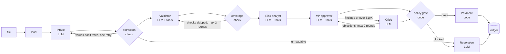

# Design

**Agents investigate and decide; code supplies the facts and guards the money.**

- Every invoice ends **PAID** or **REJECTED**. A rejection carries a disposition: `return_to_vendor` (they can fix it) or `void` (it must not come back). No run waits on a person.
- Agents plan which checks to run, call tools, weigh evidence, argue and revise.
- Tools do every sum and lookup, so an agent can't miscount stock or invent a total.
- A deterministic policy gate sits in front of payment. An agent can be stricter than policy, never looser.
- Invoice text is untrusted input. Every prompt wraps it and labels it as data, and fences off findings and risk quotes that repeat it.

## Flow

LangGraph runs it: the wiring is in `invoice_agents/graph.py`, the nodes and routing rules in `invoice_agents/nodes.py`. Each node is a function over one `State` dict; the conditional edges are the three loops and the gate.

## Agents

| Agent | File | Job | Tools |
|---|---|---|---|
| Intake | `agents/intake.py` | Any file to one `Invoice` (structured output). Missing stays null; misprints are corrected and logged with the text as written. | none |
| Validator | `agents/validator.py` | Plans and runs the checks. | `resolve_item`, `check_stock`, `check_price`, `check_totals`, `check_duplicate`, `get_vendor` |
| Risk analyst | `agents/risk.py` | Reads the original document for pressure, payment redirection, injected instructions, vendor changes. Every signal must quote the document verbatim; code drops any quote it can't find. | `get_vendor` |
| VP approver | `agents/approver.py` | Approves or rejects with reasons that cite finding IDs, reading the findings, the validator's notes and the risk memo. Over $10K it must address every finding and the risk memo. | `get_vendor` |
| Critic | `agents/critic.py` | Attacks the draft: ignored findings, unsupported reasons, approvals looser than policy. Code adds the objections that are matters of rule. | none |
| Payment | `agents/payment.py` | The only holder of `mock_payment`. Runs after the gate. Idempotency key, retries, ledger write. No model. | `mock_payment` |
| Resolution | `agents/resolution.py` | For each rejection: audit reasoning, disposition, and a drafted email to the vendor when they can fix it. An invoice held for manual entry gets no agent and no email. When policy overrides the agent's disposition, its reasoning is replaced with the rule that decided. | none |

Code-only guards: the extraction check (`rules.extraction_errors`), the coverage check (`ToolBox.missing_checks`), the policy gate (`policy.gate`).

## The three loops

1. **Intake ⇄ extraction check.** Every number and name the intake agent returns must appear in the document (raw, or after reading a letter O next to digits as zero). Anything that doesn't is sent back once with the exact errors. Still failing: rejected as `UNREADABLE`, returned to the vendor.
2. **Validator ⇄ coverage.** Code confirms every line was resolved and priced, every catalog item had a stock check, and totals, duplicates and vendor ran. Missing checks go back to the agent once; after that code runs them itself and logs that it had to.
3. **VP ⇄ critic.** Runs whenever any finding exists, the total is over $10K, or the VP rejects. The critic objects, the VP revises, two critiques at most. The gate refuses to pay anything over $10K the critic hasn't seen, and any approval the critic still objects to.

## Findings

| Code | Raised by | Trigger | Effect |
|---|---|---|---|
| `DATA_INTEGRITY` | rules | missing vendor or number (as read by a model), quantity ≤ 0, total ≤ 0 | reject, void |
| `DUPLICATE` | `check_duplicate` | same vendor, lines and total as an invoice already paid or rejected, under any number | reject, void |
| `FRAUD_SIGNALS` | `check_stock`, rules, risk analyst | zero-stock item; instruction-like text aimed at the reviewer; a high-risk memo with a verified quote of pressure, redirection, injection or a vendor change | reject, void |
| `NEEDS_MODEL` | intake or risk fallback | no model answered, and either the rules can't read the layout or the document has text they don't read: notes, an email body, a letterhead, any line outside the invoice fields, a prose field in JSON, CSV or XML | reject, manual entry |
| `UNREAD_VALUE` | rules | a quantity or total nobody could read as a number (written in words, say); when the rules read the file, a vendor or invoice number they couldn't find | reject, manual entry |
| `UNREADABLE` | extraction check | values still don't trace after one retry | reject, return |
| `REVISION_CONFLICT` | `check_duplicate` | same number and vendor as a decided invoice, different content; shows the delta | reject, return |
| `STOCK_EXCEEDED` | `check_stock` | quantity summed across all lines for an item exceeds stock | reject, return |
| `UNKNOWN_ITEM` | `resolve_item` | not in the catalog after normalizing spacing and dropping parenthetical notes; never fuzzy-matched, but the nearest catalog items are named as a question for the vendor | reject, return |
| `TOTAL_MISMATCH` | `check_totals` | a line, the subtotal, or lines + tax + shipping differ from what's stated by more than 1¢ | reject, return |
| `CURRENCY` | rules | not USD | reject, return |
| `PRICE_VARIANCE` | `check_price` | unit price more than 5% off the catalog price | warn |
| `DATE_ODDITY` | rules | due date missing, not a date, not after the invoice date, or more than 5 days off the stated Net terms | warn |
| `NEW_VENDOR` | `get_vendor` | vendor not in the vendor master | warn |
| `OCR_CORRECTED` | rules | intake corrected a misprinted value | info |
| `NEAR_THRESHOLD` | rules | total within 5% under the $10K line | info |

Severities, dispositions, tolerances and the $10K line live in `policy.yaml`.

## Policy gate

`policy.gate` allows payment only if:

- the final decision is approve,
- no finding has severity `reject` (an approval past one is logged as overridden),
- every required check ran (a check that kept failing blocks payment),
- the total is positive,
- anything over the approval line went through the critic, and the critic's last word was not an open objection,
- in degraded mode, the invoice has no warnings and is under the line.

Disposition is decided by policy whenever a finding decides it (`void`, then `manual_entry`, then `return_to_vendor`); the resolution agent only chooses when no finding does.

## Payment

`agents/payment.py` builds an idempotency key from vendor, invoice number and content. Before each call it writes a `pending` row; after, `success` or `failed`. A key that already succeeded is never paid again: that run is voided and writes no second PAID row. A decline is retried, up to three attempts, then `PAYMENT_FAILED`; running the invoice again retries under the same key. A call that raises (a timeout, a dropped connection) may still have moved money, so it is not retried: the row stays `pending` and the key is blocked until someone reconciles with the bank.

## Run tiers

| Tier | When | What happens |
|---|---|---|
| Live | `XAI_API_KEY` is set | Calls `grok-4.7` at `https://api.x.ai/v1` and saves each response under `evals/cassettes/<sha256>.json` |
| Replay | no key | Looks up each request by the SHA-256 of (model, messages, tools, response format) and returns the recorded response, with the cost and seconds the call took live. Tools still run for real |
| Degraded | no key and no recording for a request | That agent falls back to rules (`fallback.py`, `structured.py`) and the run is labeled degraded. JSON, CSV and XML are read by field name (a CSV with no total row is totalled from its lines) and labelled text by pattern; any other layout is held for manual entry. If the risk analyst fell back, any text the rules don't read holds the invoice for manual entry too. The gate then pays only spotless invoices under the line |

Recordings hold the request digest, the response body and how long the call took: no headers, no credentials. The 449 committed recordings predate the time field; their live times, taken from the recording runs' logs, are in `evals/recorded_latency.json`.

## Data

One SQLite file (`inventory.db`, created and seeded on first use):

- `inventory(item, stock, unit_price)`: the four rows from the brief, plus prices taken from the samples.
- `vendors(name, aliases, first_seen)`: the vendor master. QuickShip's earlier name, FastShip Ltd., is on file as an alias.
- `invoices(...)`: the ledger behind duplicate and revision checks.
- `payments(idempotency_key, ..., status, attempts)`.

Paying never reduces stock: the brief expects 1001, 1004 and 1006 to pass in any order, and decrementing would break that.

## Observability

Each run writes `runs/<run_id>/events.jsonl` (every stage, tool call and model call with tokens, latency and cost), `report.md` (the readable transcript) and `state.json` (what the dashboard shows).
